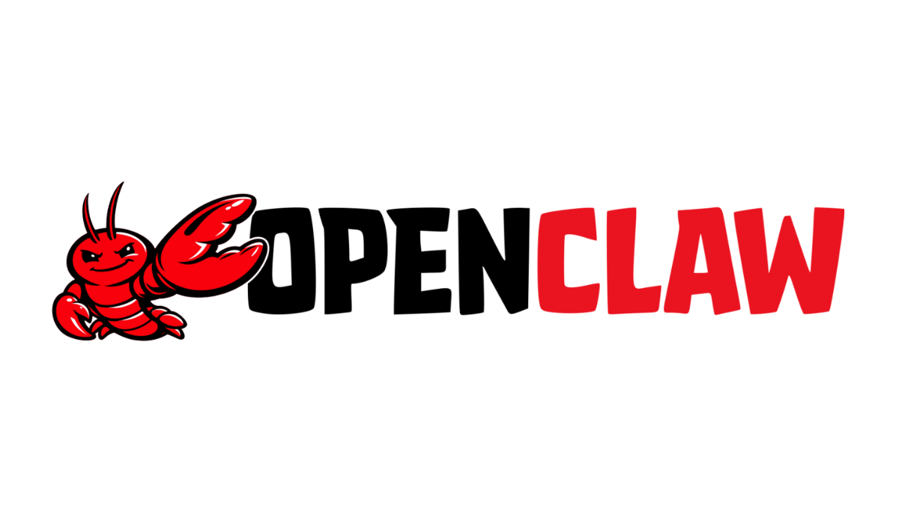

<p align="center">
  &nbsp;&nbsp;&nbsp;&nbsp;
  
</p>

<h1 align="center">适用于 OpenClaw 的 Bright Data 插件</h1>

<p align="center">
  <strong>网页搜索 · 抓取 · 浏览器自动化 · 50 多款结构化数据工具</strong><br/> 由全球领先的网络数据平台 <a href="https://www.bright.cn/">Bright Data</a> 提供支持
</p>

<p align="center">
  <a href="https://www.npmjs.com/package/@brightdata/brightdata-plugin"></a>
  <a href="https://www.npmjs.com/package/@brightdata/brightdata-plugin"></a>
  <a href="LICENSE"></a>
  <a href="https://www.bright.cn/"></a>
</p>

---

## 此插件的功能

此插件将 Bright Data 基础设施的全部强大功能直接集成到你的 OpenClaw 智能体中，无需手动连接 API，也无需配置代理。只需安装一次，你的智能体即可获得：

- 通过 Google、Bing 和 Yandex 进行支持地理定位的**实时网页搜索**
- 通过 Bright Data 网络解锁器进行**绕过机器人防护的抓取**，自动处理 CAPTCHA、JS 渲染和速率限制
- 通过由 Bright Data 住宅代理网络路由的真实 Chromium 实例实现**完整浏览器自动化**
- 适用于 Amazon、LinkedIn、Instagram、TikTok、YouTube、Reddit 等平台的 **50 多款结构化数据工具**，无需解析

---

## 安装

```bash
openclaw plugins install @brightdata/brightdata-plugin
```

---

## 配置

前往 [brightdata.com](https://www.bright.cn/) → 账户 → API 令牌，获取你的 API 令牌。

```bash
# Option A — environment variable (recommended for local dev)
export BRIGHTDATA_API_TOKEN=your_token_here

# Option B — OpenClaw config (recommended for persistent setups)
openclaw config set plugins.entries.brightdata.config.webSearch.apiKey your_token_here
```

> 首次使用时，插件会自动创建两个代理区域：`mcp_unlocker`（网络解锁器）和 `mcp_browser`（浏览器 API）。无需手动设置区域。

如需改用现有区域：

```bash
export BRIGHTDATA_UNLOCKER_ZONE=my_existing_zone
export BRIGHTDATA_BROWSER_ZONE=my_existing_browser_zone
```

---

## 工具概览

五个类别共 **66 款工具**：

| 类别 | 数量 | 功能 |
|----------|------:|-------------|
| [搜索](#搜索) | 2 | 来自 Google、Bing 和 Yandex 的实时 SERP 结果 |
| [抓取](#抓取) | 1 | 绕过机器人防护的整页数据提取 |
| 批处理 | 2 | 并行执行搜索和爬虫任务，每次最多 5 个 |
| [浏览器](#浏览器自动化) | 14 | 通过住宅代理实现完整浏览器控制 |
| [网页数据](#网页数据50-多个平台) | 47 | 来自 47 个平台的结构化数据 |

---

## 搜索

该插件会自动注册为 OpenClaw **网页搜索提供商**，并与其他提供商一同显示在搜索提供商选择界面中。

### `brightdata_search`

搜索 Google、Bing 或 Yandex，并获取结构化结果。

| 参数 | 类型 | 说明 |
|-----------|------|-------------|
| `query` | `string` | <strong>必填。</strong>搜索查询 |
| `engine` | `"google" \| "bing" \| "yandex"` | 搜索引擎（默认：`google`） |
| `count` | `number` | 返回的结果数，1–10 |
| `cursor` | `string` | 下一页的分页游标 |
| `geo_location` | `string` | 双字母 ISO 国家/地区代码（例如 `"us"`、`"de"`） |
| `timeoutSeconds` | `number` | 覆盖请求超时时间 |

### `brightdata_search_batch`

并行运行最多 5 个搜索查询。部分失败会在结果中直接返回，不会导致整个批处理失败。

---

## 抓取

### `brightdata_scrape`

通过 Bright Data 网络解锁器获取任意页面。适用于受机器人防护的网站、JavaScript 渲染页面和受地理限制的内容。

| 参数 | 类型 | 说明 |
|-----------|------|-------------|
| `url` | `string` | <strong>必填。</strong>要抓取的 HTTP/HTTPS URL |
| `extractMode` | `"markdown" \| "text" \| "html"` | 输出格式（默认：`markdown`） |
| `maxChars` | `number` | 返回的最大字符数（最小值：100） |
| `timeoutSeconds` | `number` | 覆盖请求超时时间 |

### `brightdata_scrape_batch`

使用相同的数据提取选项并行抓取最多 5 个 URL。

---

## 浏览器自动化

通过 Bright Data 住宅代理网络路由，实现完整的 Chromium 浏览器控制。系统会根据每个用户上下文自动限定会话范围，并在空闲 10 分钟后超时。

| 工具 | 说明 |
|------|-------------|
| `brightdata_browser_navigate` | 导航至 URL（可选国家/地区路由） |
| `brightdata_browser_snapshot` | 捕获包含交互式元素引用的 ARIA 快照 |
| `brightdata_browser_click` | 通过元素的快照引用点击该元素 |
| `brightdata_browser_type` | 通过引用在字段中输入内容（可选按 Enter 提交） |
| `brightdata_browser_fill_form` | 通过单次操作填写多个表单字段 |
| `brightdata_browser_screenshot` | 截取屏幕截图（视口或完整页面） |
| `brightdata_browser_get_html` | 获取当前页面 HTML |
| `brightdata_browser_get_text` | 获取当前页面的文本内容 |
| `brightdata_browser_scroll` | 滚动至页面底部 |
| `brightdata_browser_scroll_to` | 通过引用滚动至特定元素 |
| `brightdata_browser_wait_for` | 等待元素变为可见 |
| `brightdata_browser_network_requests` | 列出页面加载以来的网络请求 |
| `brightdata_browser_go_back` | 后退 |
| `brightdata_browser_go_forward` | 前进 |

---

## 网页数据：50 多个平台

通过 Bright Data 数据集从真实页面获取结构化数据。每款工具均接受 `url` 或 `keyword`，并返回干净且类型明确的 JSON，无需爬虫抓取或解析。

<details>
<summary><strong>电子商务（10 款工具）</strong></summary>

| 工具 | 数据 |
|------|------|
| `brightdata_amazon_product` | 商品详情、价格和规格 |
| `brightdata_amazon_product_reviews` | 客户评论和评分 |
| `brightdata_amazon_product_search` | 包含排名的搜索结果 |
| `brightdata_walmart_product` | 商品详情和库存情况 |
| `brightdata_walmart_seller` | 卖家资料和指标 |
| `brightdata_ebay_product` | 商品刊登详情和出价 |
| `brightdata_homedepot_products` | 商品目录和价格 |
| `brightdata_zara_products` | 时尚商品目录数据 |
| `brightdata_etsy_products` | 手工制品和复古商品刊登信息 |
| `brightdata_bestbuy_products` | 电子产品目录和优惠 |

</details>

<details>
<summary><strong>职业社交网络（7 款工具）</strong></summary>

| 工具 | 数据 |
|------|------|
| `brightdata_linkedin_person_profile` | 完整个人资料 |
| `brightdata_linkedin_company_profile` | 公司概况和统计数据 |
| `brightdata_linkedin_job_listings` | 包含详细信息的空缺职位 |
| `brightdata_linkedin_posts` | 帖子内容和互动数据 |
| `brightdata_linkedin_people_search` | 人员搜索结果 |
| `brightdata_crunchbase_company` | 融资、投资者和创始人 |
| `brightdata_zoominfo_company_profile` | 公司情报数据 |

</details>

<details>
<summary><strong>社交媒体（17 款工具）</strong></summary>

**Instagram**
| 工具 | 数据 |
|------|------|
| `brightdata_instagram_profiles` | 个人资料统计数据和简介 |
| `brightdata_instagram_posts` | 帖子内容和互动数据 |
| `brightdata_instagram_reels` | Reel 元数据和观看次数 |
| `brightdata_instagram_comments` | 评论串 |

**Facebook**
| 工具 | 数据 |
|------|------|
| `brightdata_facebook_posts` | 帖子内容和回应 |
| `brightdata_facebook_marketplace_listings` | Marketplace 商品 |
| `brightdata_facebook_company_reviews` | 页面评论和评分 |
| `brightdata_facebook_events` | 活动详情和参与人数 |

**TikTok**
| 工具 | 数据 |
|------|------|
| `brightdata_tiktok_profiles` | 创作者资料和统计数据 |
| `brightdata_tiktok_posts` | 视频内容和指标 |
| `brightdata_tiktok_shop` | TikTok Shop 商品数据 |
| `brightdata_tiktok_comments` | 评论串 |

**X (Twitter)**
| 工具 | 数据 |
|------|------|
| `brightdata_x_posts` | 帖子内容和指标 |
| `brightdata_x_profile_posts` | 个人资料帖子历史记录 |

**YouTube 和 Reddit**
| 工具 | 数据 |
|------|------|
| `brightdata_youtube_profiles` | 频道统计数据和信息 |
| `brightdata_youtube_videos` | 视频详情和指标 |
| `brightdata_youtube_comments` | 评论串 |
| `brightdata_reddit_posts` | 帖子内容和评分 |

</details>

<details>
<summary><strong>地图、购物和应用（4 款工具）</strong></summary>

| 工具 | 数据 |
|------|------|
| `brightdata_google_maps_reviews` | 地点评论和评分 |
| `brightdata_google_shopping` | 购物结果和价格 |
| `brightdata_google_play_store` | 应用详情和评论 |
| `brightdata_apple_app_store` | 应用详情和评论 |

</details>

<details>
<summary><strong>金融、新闻和代码（3 款工具）</strong></summary>

| 工具 | 数据 |
|------|------|
| `brightdata_reuter_news` | 路透社新闻文章 |
| `brightdata_yahoo_finance_business` | 公司财务数据和新闻 |
| `brightdata_github_repository_file` | 代码仓库文件内容 |

</details>

<details>
<summary><strong>房地产和旅行（2 款工具）</strong></summary>

| 工具 | 数据 |
|------|------|
| `brightdata_zillow_properties_listing` | 房产信息和估价 |
| `brightdata_booking_hotel_listings` | 酒店信息和价格 |

</details>

<details>
<summary><strong>AI 洞察（3 款工具）</strong></summary>

| 工具 | 数据 |
|------|------|
| `brightdata_chatgpt_ai_insights` | ChatGPT 回答 |
| `brightdata_grok_ai_insights` | Grok 回答 |
| `brightdata_perplexity_ai_insights` | Perplexity 回答 |

</details>

---

## 配置参考

所有设置均可通过环境变量或 OpenClaw 配置提供。环境变量优先。

| 设置 | 环境变量 | 配置路径 | 默认值 |
|---------|---------------------|-------------|---------|
| API 令牌 | `BRIGHTDATA_API_TOKEN` | `...webSearch.apiKey` | **必填** |
| 基础 URL | `BRIGHTDATA_BASE_URL` | `...webSearch.baseUrl` | `https://api.brightdata.com` |
| 解锁器区域 | `BRIGHTDATA_UNLOCKER_ZONE` | `...webSearch.unlockerZone` | `mcp_unlocker` |
| 浏览器区域 | `BRIGHTDATA_BROWSER_ZONE` | `...webSearch.browserZone` | `mcp_browser` |
| 请求超时时间 | — | `...webSearch.timeoutSeconds` | `30s` 搜索 / `60s` 抓取 |
| 轮询超时时间 | — | `...webSearch.pollingTimeoutSeconds` | `600s` |

> 配置路径均以 `plugins.entries.brightdata.config` 为前缀。

---

## 插件管理

```bash
# Install
openclaw plugins install @brightdata/brightdata-plugin

# Verify installation and loaded tools
openclaw plugins inspect brightdata

# Update to latest version
openclaw plugins update brightdata

# Temporarily disable
openclaw plugins disable brightdata

# Re-enable
openclaw plugins enable brightdata

# Uninstall
openclaw plugins uninstall brightdata
```

---

## 要求

- 已安装并运行 OpenClaw
- 拥有带 API 令牌的 [Bright Data 账户](https://www.bright.cn/)
- Node.js 22+（由 OpenClaw 管理）

---

## 许可证

MIT © [Bright Data](https://www.bright.cn/)
